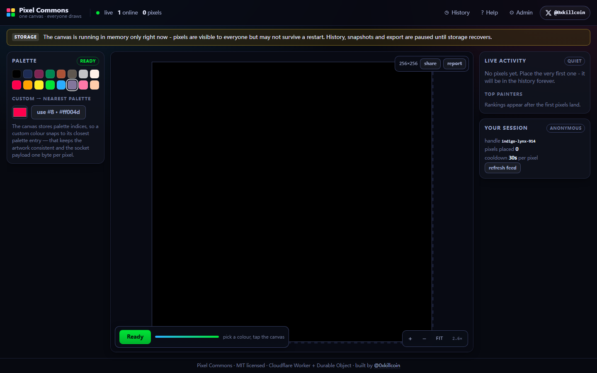
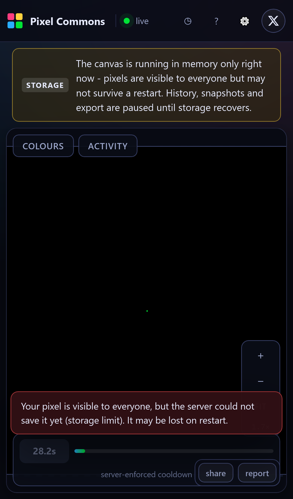
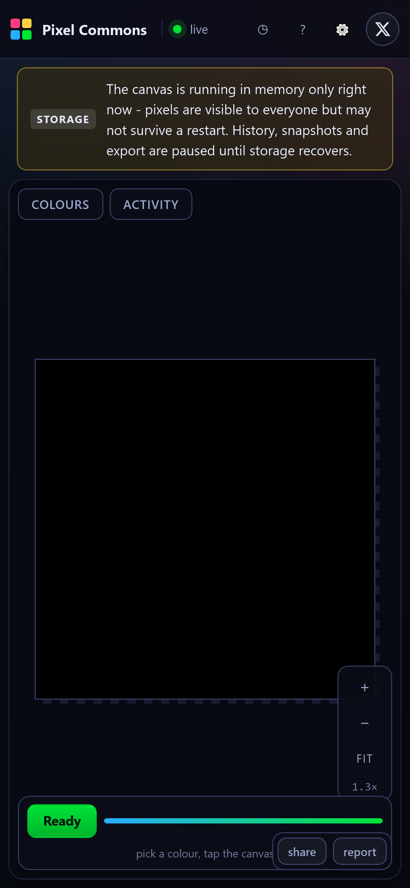
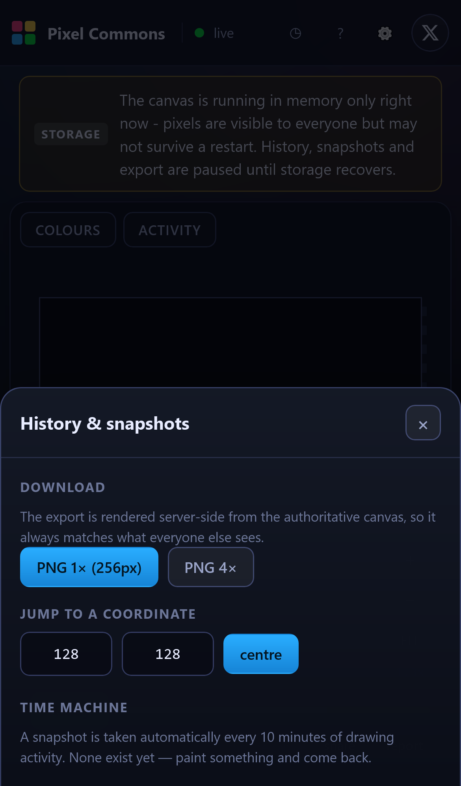
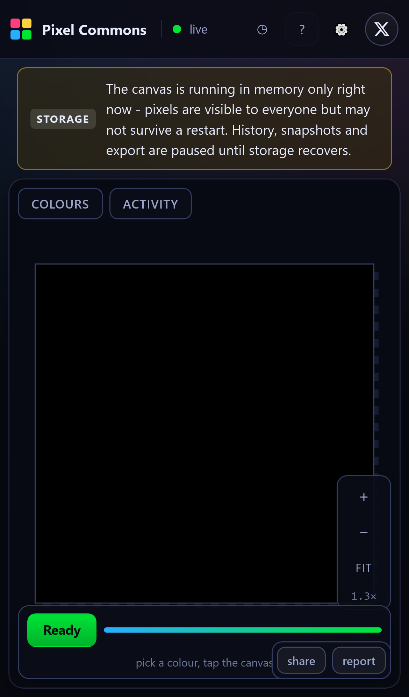

# Pixel Commons

> **One canvas. Everyone draws on it. One pixel at a time.**
> A real-time, multi-user pixel canvas where every write is validated by the server, throttled by a fair cooldown, and kept forever in a public history.

[](https://pixel-commons.pages.dev)
[](LICENSE)
[](#testing)
[](docs/ARCHITECTURE.md)

**[Open the live canvas](https://pixel-commons.pages.dev)** | **[Follow the maker on X @0xkillcoin](https://x.com/0xkillcoin)**

---

## What is this?

Pixel Commons is a shared 256 x 256 pixel canvas. There is exactly **one** artwork. Every visitor draws on the
same board, so the picture is the accumulated result of everyone who ever showed up - a slow, cooperative
mural that nobody owns and everybody builds.

Think of `/r/place`, but small enough to understand end-to-end: one Durable Object holds the authoritative
canvas, every pixel change is a byte-sized delta over a WebSocket, and a **server-enforced 30 second cooldown**
means a single person cannot out-paint a crowd.

It solves a specific problem that most "collaborative canvas" demos quietly dodge: **who decides what is
true?** In Pixel Commons the client never decides. The client cannot grant itself a cooldown reset, cannot
claim another user's turn, cannot write outside the canvas, and cannot pick a colour that is not in the
palette. The browser is a renderer and an input device; the Durable Object is the referee.

---

## Screenshots

All screenshots are captured from the deployed build by the Playwright suite - no mockups.

| Desktop | iPhone 13 |
| --- | --- |
|  |  |

| Two browsers, one canvas | History and snapshots |
| --- | --- |
|  |  |

| Rules and help |
| --- |
|  |

---

## Features

### The core loop
- **One shared canvas** - 256 x 256 by default, configurable up to 1024 x 1024.
- **Live presence** - online count, live activity feed and a top-painters board, all server-sourced.
- **Server-authored pixels** - the server echoes the accepted pixel (colour + timestamp + history id) back
  to its author, so the UI can never show something the server did not accept.
- **Server-enforced cooldown** - 30 s per anonymous session (configurable). The countdown you see is the
  server's deadline, not a local timer.
- **Delta broadcasting** - a change is `{x, y, c}`; the full canvas is only sent once per connection as an
  RLE blob (a few hundred bytes for a realistic drawing).

### Drawing tools
- 16-colour PICO-8 palette, recent colours, and a custom colour picker that snaps to the nearest palette entry.
- Mouse: scroll to zoom, drag to pan, click to place. Touch: pinch to zoom, one-finger pan, tap to place.
- Zoom controls (`+`, `-`, `fit`), coordinate readout, crisp nearest-neighbour rendering, optional grid.
- **Shareable deep links** - `?x=64&y=96&z=12` opens centred on a pixel at a chosen zoom.
- **PNG export** rendered server-side at 1x to 16x, so the file always matches the authoritative canvas.

### History and time travel
- Per-pixel history: who (stable anonymous handle), when, and which colour it replaced.
- Automatic snapshots every 10 minutes of activity, each downloadable as a PNG.
- Admin `undo` reverts the last accepted pixel to its previous colour.

### Moderation and admin
- Report a pixel (shift-click on desktop, long-press on touch) into a moderation queue.
- Admin console: publish an info / warning / **maintenance** notice (maintenance blocks painting),
  undo, reset the canvas, resolve or reject reports, rename the canvas.
- Every admin action is written to an append-only audit trail visible in the console.
- Admin rights live in a signed, HttpOnly cookie; the UI merely hides buttons, the server always re-checks.

### Robustness
- Auto-reconnect with exponential backoff, heartbeat ping, and history replay from the last seen id.
- Distinct UX for connecting / live / reconnecting / offline / expired-session.
- Rate limits per connection (12 msg/s, 40 writes/10 s) and per session (reports), plus a global pixel budget.
- Explicit feedback for every rejection reason (`cooldown`, `out_of_bounds`, `bad_color`, `rate_limited`,
  `maintenance`, `unchanged`, ...).

---

## Quick start

```bash
git clone https://github.com/iiiiiiiiiiiiiKK/pixel-commons.git
cd pixel-commons
npm install

# 1. local secrets (never commit this file)
cp .env.example .dev.vars
node -e "console.log('SESSION_SECRET=' + require('crypto').randomBytes(32).toString('base64url'))" >> .dev.vars
node -e "console.log('ADMIN_TOKEN=pc_' + require('crypto').randomBytes(24).toString('base64url'))" >> .dev.vars

# 2. build the front-end once so the Worker can serve it
npm run build

# 3. run the full stack (Worker + Durable Object + assets) on http://127.0.0.1:8787
npx wrangler dev
```

> `npm run dev` starts only the Vite dev server (port 5173) and proxies `/api` + `/ws` to `wrangler dev`.
> Run both if you want hot reload: `npx wrangler dev` in one terminal, `npm run dev` in another.

### Useful scripts

| Command | What it does |
| --- | --- |
| `npm run dev` | Vite dev server with API/WS proxy |
| `npm run build` | Typecheck + production build into `dist/` |
| `npm run typecheck` | `tsc` for the app and the Worker |
| `npm test` | Unit + Durable Object authority tests (39) |
| `node tests/integration.mjs` | 43-check live integration suite (HTTP + WebSocket) |
| `npm run test:e2e` | Playwright, desktop Chromium **and** iPhone 13 WebKit |
| `npx wrangler deploy` | Deploy the Worker + Durable Object |
| `node scripts/deploy.mjs --pages` | Build + deploy Worker and Pages together |
| `node scripts/paint.mjs` | Seed the canvas with a small starter scene |

---

## Architecture

```
                  +----------------------------------------------+
   browser  ----> |  React 18 + TypeScript + Vite                |
   (desktop,      |  - canvas renderer (offscreen 1px board)     |
    iPhone)       |  - palette / cooldown / activity / admin UI  |
                  +----------------------+-----------------------+
                                         |  HTTPS /api/*   WSS /ws
                  +----------------------v-----------------------+
                  |  Cloudflare Pages (pixel-commons.pages.dev)  |
                  |  static assets + functions/[[path]].ts       |
                  +----------------------+-----------------------+
                                         |  service binding (keeps 101)
                  +----------------------v-----------------------+
                  |  Cloudflare Worker (pixel-commons)           |
                  |  - session cookies (HMAC-signed, anonymous)  |
                  |  - CORS + route surface                      |
                  |  - PNG encoder (server-side export)          |
                  +----------------------+-----------------------+
                                         |  Durable Object RPC
                  +----------------------v-----------------------+
                  |  CanvasRoom  (one SQLite-backed DO)          |
                  |  - authoritative canvas + cooldowns          |
                  |  - WebSocket fan-out, rate limits            |
                  |  - history, snapshots, reports, audit        |
                  +----------------------------------------------+
```

Full details, data model and design trade-offs: [`docs/ARCHITECTURE.md`](docs/ARCHITECTURE.md).

### Tech stack

| Layer | Choice | Why |
| --- | --- | --- |
| Front-end | React 18, TypeScript, Vite | Small bundle, no framework runtime overhead, first-class Canvas interop |
| Rendering | Canvas 2D, offscreen 1px board + nearest-neighbour blit | 65 536 cells stay at 60 fps; a delta is a single 1x1 `fillRect` |
| Realtime | WebSocket via Durable Object | One authoritative writer, ordered fan-out, no polling |
| State | Durable Object SQLite (`storage.sql`) | Strong consistency per canvas, transactions, no external DB |
| Deploy | Cloudflare Worker + Pages | WebSocket-capable runtime on a free tier, global edge |
| Tests | Vitest, Node integration script, Playwright | Nothing mocked: the suites talk to the deployed origin |

---

## Configuration

All runtime configuration is environment variables / platform secrets. Nothing sensitive is ever in the repo.

| Variable | Required | Default | Purpose |
| --- | --- | --- | --- |
| `SESSION_SECRET` | **yes** | - | HMAC key for anonymous session + admin cookies |
| `ADMIN_TOKEN` | no | *(unset: admin disabled)* | Token for the admin console |
| `ALLOWED_ORIGINS` | no | *(same origin only)* | Comma-separated extra origins allowed to call the API (e.g. the GitHub Pages build) |
| `CANVAS_WIDTH` / `CANVAS_HEIGHT` | no | `256` | Canvas geometry (32-1024) |
| `CANVAS_NAME` | no | `Pixel Commons` | Display name |
| `CANVAS_PALETTE` | no | PICO-8 16 colours | Comma-separated `#rrggbb` palette (2-32 entries) |
| `COOLDOWN_SECONDS` | no | `30` | Per-session cooldown (0-3600) |
| `DEBUG_ERRORS` | no | *(off)* | `1` includes error text in 500 responses |

See [`.env.example`](.env.example). Generate secrets with:

```bash
node -e "console.log(require('crypto').randomBytes(32).toString('base64url'))"
```

---

## Deployment

The canonical deployment is **one Worker** that owns both the API and the Durable Object, plus an optional
**Pages** project that serves the static front-end and forwards `/api` + `/ws` to the Worker.

```bash
# 1. secrets (once per account)
npx wrangler secret put SESSION_SECRET
npx wrangler secret put ADMIN_TOKEN

# 2. Worker + Durable Object
npm run build && npx wrangler deploy

# 3. Pages project (static site + functions proxy)
npx wrangler pages deploy dist --project-name pixel-commons --branch main
```

Then bind Pages to the Worker so WebSockets survive the hop (Pages cannot answer `101` itself):

```bash
# Dashboard: Workers & Pages > pixel-commons (Pages) > Settings > Bindings
#   Service binding:      BACKEND  ->  pixel-commons  (production)
#   Plain text variable:  ALLOWED_ORIGINS  ->  https://<you>.github.io
```

`wrangler.pages.jsonc` documents the equivalent declarative config. Full walkthrough, including the
GitHub Pages variant and the WebSocket limitation behind it: [`docs/DEPLOYMENT.md`](docs/DEPLOYMENT.md).

### Deploying the front-end to GitHub Pages

GitHub Pages is static-only, so it **cannot** host the realtime backend. Pixel Commons therefore ships a
static build that points at the Worker:

```bash
VITE_API_BASE=https://pixel-commons.pages.dev VITE_BASE=/pixel-commons/ \
  npx vite build --outDir dist-pages
# publish dist-pages/ to the gh-pages branch
```

The API then sees a cross-site request, so it switches to `SameSite=None; Secure` cookies and only accepts
the origins listed in `ALLOWED_ORIGINS`. See the deployment guide for the exact steps and caveats.

---

## Testing

Everything here was executed against the deployed origin - no mocks, no "should work".

| Suite | Command | Result |
| --- | --- | --- |
| Unit + Durable Object authority (incl. simulated restart and storage-degradation paths) | `npm test` | **39 / 39 passed** |
| Integration (HTTP + WebSocket, live origin) | `node tests/integration.mjs` | **40 / 40 passed** |
| E2E desktop (Chromium 1440x900) | `npm run test:e2e -- --project=desktop-chromium` | **7 passed, 1 skipped** (phone-only) |
| E2E mobile (iPhone 13, real WebKit) | `npm run test:e2e -- --project=iphone-13` | **8 passed** |

What the integration suite actually asserts (each line is a real check, not a smoke test):

cooldown enforcement, per-session (not global) cooldown, broadcast fan-out to other sockets, out-of-bounds
rejection, out-of-palette rejection, malformed payload rejection, unknown message rejection,
per-connection flood rate limiting, a definitive answer for every report, presence counting, persistence over
HTTP, history author attribution, reconnect with cursor replay, identity stability across reconnect, real PNG
export with correct IHDR dimensions, snapshot index, admin auth (wrong token / no token / valid token),
notice publish + clear, undo verdict, audit trail readability, anonymous reset blocked, sessionless WebSocket
refused, static front-end served, 12 concurrent sockets, and fan-out latency.

The suite is degradation-aware on purpose: when the server reports `storageHealthy: false` it prints a
`SKIP` line for the checks that require durable storage instead of silently downgrading them, so the summary
never claims a persistence test passed when it could not run.

**Measured on the production deployment** (2026-10-25, 12 concurrent sockets, two runs):

```
12 concurrent websocket clients connect      - 1.1 s and 1.65 s per handshake
broadcast fan-out to 12 clients              - 6/6 delivered, avg 250 ms and 309 ms
```

These are the *observed* numbers for this single-region Durable Object from one client machine, not a claim
of unlimited scale. See [Known limitations](#known-limitations).

Diagnostics: `GET /api/health` returns geometry + cooldown; `GET /healthz` is a bare 200 for uptime probes.

---

## Security and privacy

| Area | Implementation |
| --- | --- |
| Identity | Anonymous 128-bit session id in an HMAC-signed, `HttpOnly` cookie. No email, no password, no fingerprinting. |
| Display handle | Derived from `SHA-256("handle:" + sessionId)` -> `adjective-animal-123`. Stable per session, reveals nothing. |
| Authority | Cooldown, palette bounds, geometry, rate limits and admin rights are all decided in the Durable Object. |
| Forged cookies | A cookie without a valid HMAC is discarded and replaced with a fresh identity, never trusted. |
| Privilege | Admin actions require a signed admin cookie; the token is compared in constant time and login attempts are throttled. |
| Abuse | Per-connection message budget, per-connection write burst limiter, per-session report limiter, global pixel budget, message size cap. |
| Content | Report queue with statuses, audit trail of every admin action, maintenance mode that blocks writes. |
| Transport | HTTPS/WSS only on deployed origins; cookies get `Secure` plus `SameSite=None` **only** for opted-in cross-site builds. |
| CORS | Same-origin by default; additional origins must be listed explicitly in `ALLOWED_ORIGINS`. |
| Secrets | Platform secrets only (`.dev.vars` locally, both gitignored). Nothing sensitive in the repo, README or history. |
| Dependencies | `npm audit` reports **0 vulnerabilities** at the time of writing (an `overrides` entry pins `undici` past a known advisory). |

**Privacy in one sentence:** Pixel Commons stores a random session id, a derived nickname, a pixel counter,
and the pixels themselves - nothing else, and no third-party analytics.

Details and threat model: [`docs/SECURITY.md`](docs/SECURITY.md).

---

## Community rules

1. One pixel per 30 seconds, per person. The server enforces it - extra tabs do not help.
2. Draw something that makes the canvas better. Racism, harassment, sexual content and advertising get removed.
3. Do not script around the cooldown. Automated sessions are rate-limited and may be wiped.
4. Reports are for genuinely bad content. Misusing them is rate-limited.
5. Admins log every action. If you think a decision was wrong, open an issue.

Full governance (moderation levels, appeal path, reset policy, data retention):
[`docs/GOVERNANCE.md`](docs/GOVERNANCE.md).

---

## Project structure

```
pixel-commons/
|-- shared/                     # protocol types + RLE/palette codec shared by both sides
|   |-- protocol.ts
|   `-- rle.ts
|-- worker/                     # Cloudflare Worker
|   |-- index.ts                # entry: exports CanvasRoom + fetch handler
|   |-- app.ts                  # routing, sessions, CORS, admin auth, JSON API
|   |-- durable-object.ts       # CanvasRoom: authoritative canvas, WS, limits, history
|   |-- session.ts              # HMAC cookies, handles
|   |-- png.ts                  # dependency-free PNG encoder (CompressionStream)
|   `-- env.ts
|-- functions/
|   `-- [[path]].ts             # Pages Functions: static + /api,/ws forwarder
|-- src/                        # React front-end
|   |-- App.tsx
|   |-- components/             # PixelCanvas, Panels, AdminConsole
|   |-- lib/                    # socket hook, typed API client
|   `-- styles.css
|-- tests/
|   |-- rle.test.ts             # codec unit tests
|   |-- durable-object.test.ts  # runs the real DO class against node:sqlite
|   |-- integration.mjs         # 43 checks against a live origin
|   `-- e2e/app.spec.ts         # Playwright desktop + iPhone
|-- scripts/                    # deploy helper, canvas seeding, API publisher
|-- docs/                       # architecture, deployment, security, governance, testing
|-- wrangler.jsonc              # Worker config (DO + assets + migrations)
`-- wrangler.pages.jsonc        # Pages config (static + service binding)
```

---

## Known limitations

Honest list - these are real, and the README does not pretend otherwise.

- **GitHub Pages alone cannot run this.** Pages is static hosting; the realtime backend needs a Worker with a
  Durable Object. The Pages build is a *front-end* that talks to the Worker API.
- **One Durable Object = one canvas, single-region.** That is the point (strong consistency), but it means
  latency is dominated by the distance to that object's region, and there is no sharding across many canvases
  in the current code.
- **Cooldown is per browser session, not per human.** Clearing cookies grants a new identity; that is the
  deliberate trade-off of no accounts. Automated abuse is mitigated by rate limits, not eliminated.
- **Free-tier ceilings apply, and they are real.** Workers Free includes 100k requests/day and 13k GB-s/day of
  Durable Object compute, while Durable Objects Free also caps **rows read per day**. Seeding the canvas with
  ~3 300 pixels exhausted the daily row-read quota on this deployment while the first storage layout was in
  place. Two things changed as a result: the board is now one packed RLE row (zero reads per pixel write), and
  the room *degrades* instead of dying when storage refuses - sockets keep working, pixels still reach every
  viewer, and the UI says plainly that they may not be persisted. Hosting was reported transparently rather
  than hidden: at the time of writing the live demo is in that degraded mode because the quota was consumed
  during testing. It resets daily at 00:00 UTC. No paid plan was purchased and none is required to run this
  repo.
- **Snapshots are activity-triggered, capped at 96**, and take ~77 kB each in the worst case. There is no
  arbitrary "rewind to timestamp" endpoint beyond the stored snapshots.
- **The `workers.dev` hostname is unreachable from some networks** (observed: blocked on the deployment
  network used here). The Pages domain was used for verification for that reason; both hosts serve the same
  Worker.
- **No account system, no cross-device identity.** A drawing is anonymous and permanent per session.
- **`wrangler dev` fails on this Windows host** (`workerd` crashes with a stack overflow - an environment
  issue that also reproduces with a minimal config and older workerd builds, not a project bug). Verification
  therefore ran against the deployed origin plus a Node-based harness that executes the real Durable Object
  class; see `docs/TESTING.md`.

---

## Roadmap

- [x] Server-authoritative pixels, cooldown, delta broadcast
- [x] Anonymous sessions, presence, activity feed, leaderboard
- [x] History, snapshots, PNG export, shareable deep links
- [x] Moderation queue, admin console, audit trail, maintenance mode
- [x] Desktop + iPhone responsive UI, touch gestures, reconnect UX
- [ ] Themed events / limited palettes per day
- [ ] Team or faction canvases with scoped permissions
- [ ] WebSocket hibernation to cut Durable Object duration further
- [ ] R2-backed long-term backups on a cron trigger

---

## Contributing

Issues and pull requests are welcome. Please run `npm run typecheck && npm test` before opening a PR, and
keep the "server decides" invariant intact - a PR that moves authority into the browser will be rejected.

See [`CONTRIBUTING.md`](CONTRIBUTING.md).

---

## License

[MIT](LICENSE) (c) Pixel Commons contributors.

Built by [@0xkillcoin](https://x.com/0xkillcoin).
